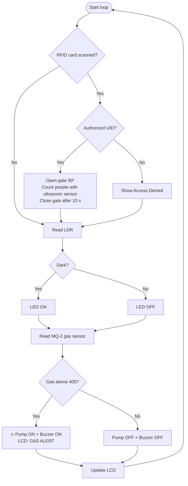
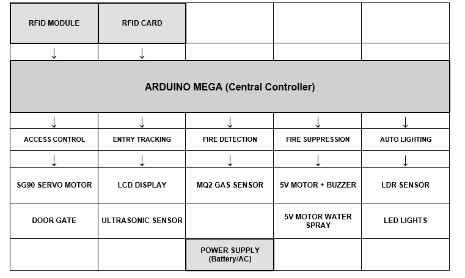
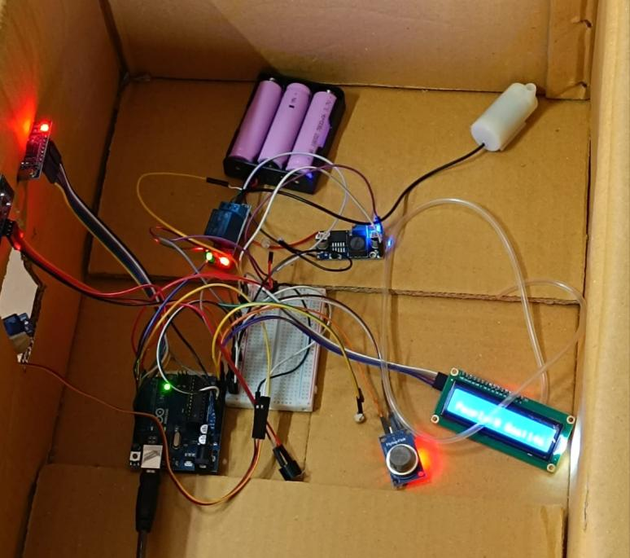
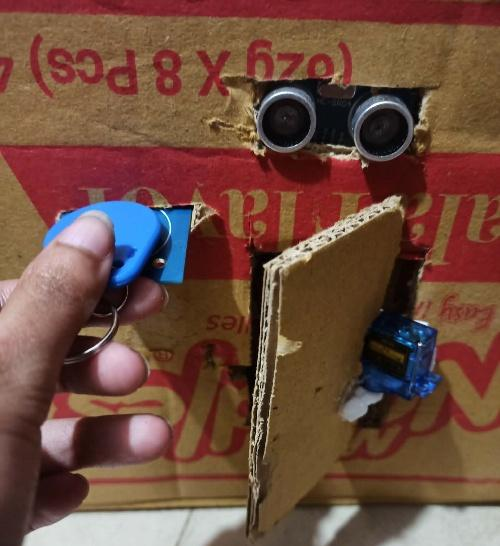
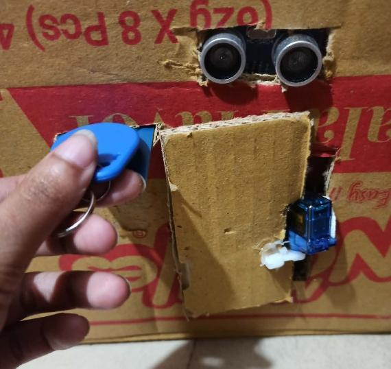
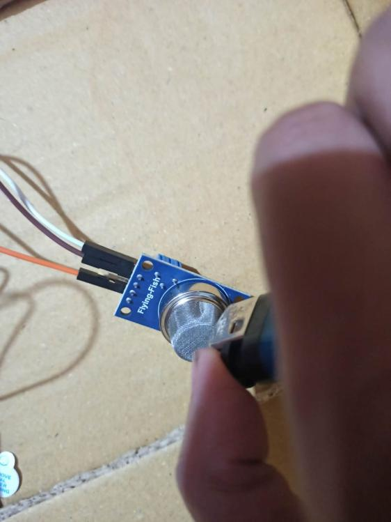
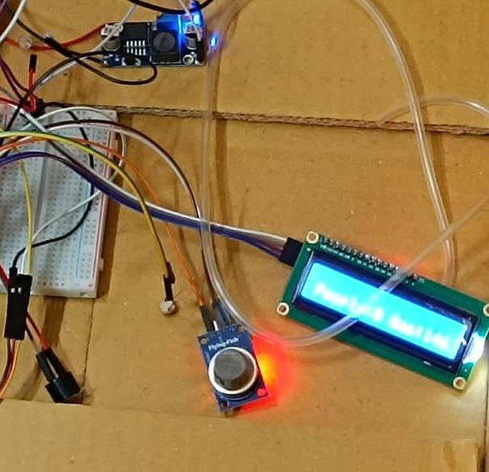
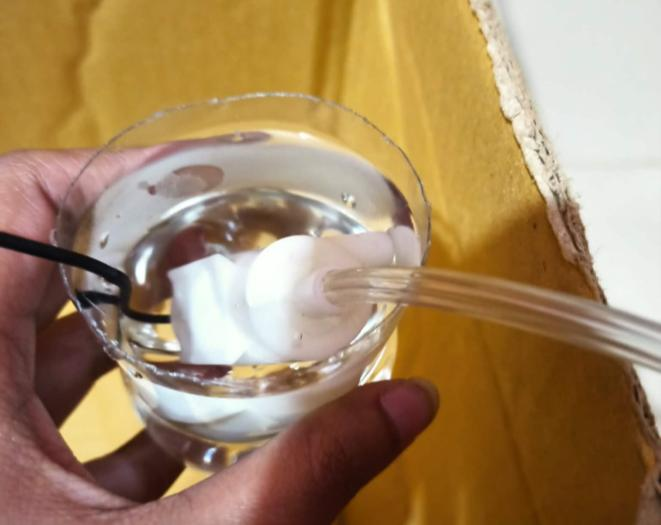
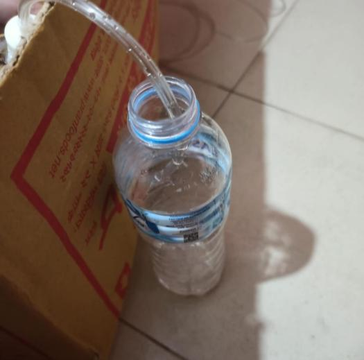

<div align="center">

# 🧳 Smart Cargo Storage System

### An Automated Approach to Airport Cargo Safety and Security

**One Arduino. Secure RFID access, automatic people counting, smart lighting, and a fire alarm that fights back with water.**


</div>

---
## 📖 About the Project

Cargo facilities in many developing regions still depend on **manual entry registers** and **passive fire alarms**. Registers are slow and easy to get wrong, and a normal alarm only makes noise. It cannot stop a fire. The fire incident at Shahjalal International Airport showed how costly that gap can be.

The **Smart Cargo Storage System (SCSS)** closes it with a single low-cost, microcontroller-based unit that:

- 🔐 verifies who enters using **RFID cards**,
- 👥 counts every entry automatically,
- 💡 turns the lights on only when it is dark, and
- 🔥 **detects smoke and starts a water pump on its own**, without waiting for a person.

Everything runs locally on the Arduino, so the fire protection keeps working **even without internet**.

---

## ✨ Features

| | Feature | What it does |
|---|---|---|
| 🔐 | **RFID Access Control** | The MFRC522 reader checks the card UID against a list of authorized cards. A valid card opens the gate (servo, 90°) for 10 seconds, an invalid one shows *Access Denied*. |
| 👥 | **Entry Tracking** | An ultrasonic sensor counts people or vehicles passing within 20 cm. A 1.5 second delay prevents double counting. The live count is shown on the LCD. |
| 🔥 | **Fire Detection and Suppression** | The MQ-2 sensor watches for smoke. Above the threshold the relay starts the water pump, the buzzer sounds, and the LCD shows **GAS ALERT**. |
| 💡 | **Smart Lighting** | An LDR switches an LED on in low light and off in daylight, saving energy. |
| 🛡️ | **Dual-Loop Failsafe** | Security and safety run in independent parts of the loop, so the fire system still works even if the RFID reader gets stuck. |
| 📟 | **Live LCD Display** | A 16x2 I2C screen shows the people count, the gas reading, and system messages. |

---

## ⚙️ How It Works



<details>
<summary><b>🧩 System architecture (Input → Process → Output)</b></summary>

<br>

The system follows the **Input-Process-Output** model around one central controller.

<div align="center">

</div>

| Unit | Components |
|---|---|
| **Input** | MFRC522 RFID reader, HC-SR04 ultrasonic sensor, MQ-2 gas sensor, LDR |
| **Processing** | Arduino UNO R3 (ATmega328P) |
| **Output** | SG90 servo gate, 16x2 I2C LCD, relay and water pump, buzzer, LED |

</details>

---

## 🧰 Hardware

| Component | Role |
|---|---|
| Arduino UNO R3 (ATmega328P) | Central controller |
| MFRC522 RFID reader (13.56 MHz) | Authentication |
| HC-SR04 ultrasonic sensor | Entry counting |
| MQ-2 gas sensor | Smoke detection |
| LDR with 10 kΩ pull-down | Ambient light sensing |
| SG90 servo motor | Gate barrier |
| 5V relay module and water pump | Fire suppression |
| 16x2 LCD with I2C | Status display |
| Active buzzer and white LED | Alarm and lighting |

<details>
<summary><b>📌 Pin configuration</b></summary>

<br>

| Component | Pin | Arduino UNO |
|---|---|---|
| RFID (RC522) | SDA (SS) | D10 |
| RFID (RC522) | SCK | D13 |
| RFID (RC522) | MOSI | D11 |
| RFID (RC522) | MISO | D12 |
| RFID (RC522) | RST | D9 |
| RFID (RC522) | VCC | 3.3V |
| Servo (SG90) | Signal | D6 |
| Ultrasonic (HC-SR04) | Trig | D4 |
| Ultrasonic (HC-SR04) | Echo | D5 |
| LDR | Divider output | A0 |
| LED | Anode (via 220 Ω) | D3 |
| Gas sensor (MQ-2) | AO | A1 |
| Relay module | IN | D7 |
| Buzzer | Signal | D8 |
| LCD (I2C) | SDA / SCL | A4 / A5 |

> The servo and relay should be powered from a suitable external 5V supply.

</details>

<details>
<summary><b>🔬 Circuit photo</b></summary>

<br>

<div align="center">

</div>

</details>

---

## 📊 Results

The system was tested module by module and as a whole.

| Metric | Result | Target |
|---|---|---|
| Authentication time | **800 – 950 ms** | < 1000 ms |
| Unauthorized cards rejected | **100%** (15 of 15) | — |
| Entry counting accuracy | **98.5%** (200 trials) | > 95% |
| Fire detection time | **2 – 3 seconds** | < 5 s |
| Pump activation delay | **1.8 seconds** | < 3 s |
| False alarm rate | **1.2%** | < 5% |
| Power consumption | **8.5 W** active, 2.5 W standby | < 12 W |

Smoke test: clean air read about **50 – 100** on the MQ-2, and synthetic smoke pushed it to **450 – 600**, well above the threshold of **400**.

---

## 📸 Gallery

<table>
<tr>
<td align="center"><b>Gate opens on a valid card</b><br></td>
<td align="center"><b>Gate open</b><br></td>
</tr>
<tr>
<td align="center"><b>Smoke test on the MQ-2</b><br></td>
<td align="center"><b>LCD gas alert</b><br></td>
</tr>
<tr>
<td align="center"><b>Water pump in action</b><br></td>
<td align="center"><b>Water outlet</b><br></td>
</tr>
</table>

---

## 🚀 Getting Started

### Requirements
- Arduino IDE 2.x
- Libraries: `SPI`, `MFRC522`, `Servo`, `Wire`, `LiquidCrystal_I2C`

### Steps
1. **Wire** the components using the pin table above.
2. **Clone** the repository:
   ```bash
   git clone https://github.com/IbtidaAra5/Cargo_Storage_System.git
   ```
3. **Open** the sketch in the Arduino IDE and select **Arduino UNO** as the board.
4. **Add your cards:** put the UIDs of your RFID cards into the `allowedUIDs` array.
5. **Tune the thresholds** if needed:
   ```cpp
   int lightThreshold = 1000;   // LDR: below this means dark
   int gasThreshold   = 400;    // MQ-2: above this means fire alert
   unsigned long accessDuration = 10000; // gate stays open for 10 s
   ```
6. **Upload** and power the board.

> 💡 The gas threshold is a trade-off. A lower value detects smoke earlier but can trigger the pump by mistake, and a false trigger could damage cargo. **400** was chosen to favor reliability.

---

## ⚠️ Limitations

- Needs a continuous power supply. Without a backup battery the gate and sensors stop in a power cut.
- The ultrasonic counter can miscount if several people pass together or stand very close to the sensor.
- The MQ-2 can react to dust and minor fumes, so thresholds need calibration for each site.

---

## 🗺️ Future Work

- [ ] Backup battery for uninterrupted operation
- [ ] IoT remote monitoring with an ESP32 and a mobile app
- [ ] Face recognition with computer vision for stronger security
- [ ] Logging of entry events

---


## 📄 License

This project is licensed under the **MIT License**.

<div align="center">

Built to keep cargo and the people around it safe. 🧳🔥💧

</div>
